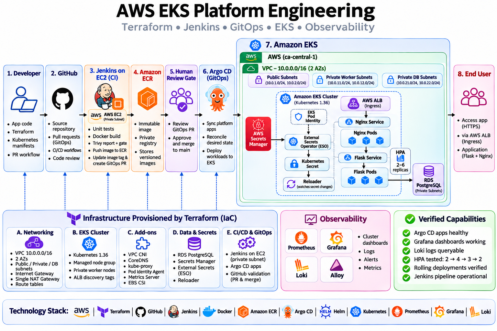
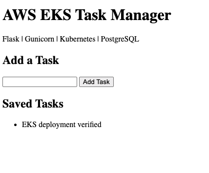
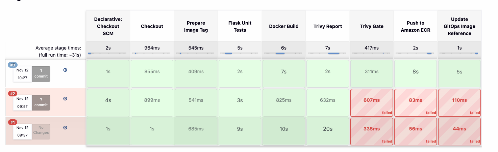
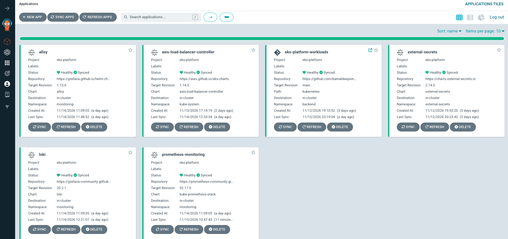
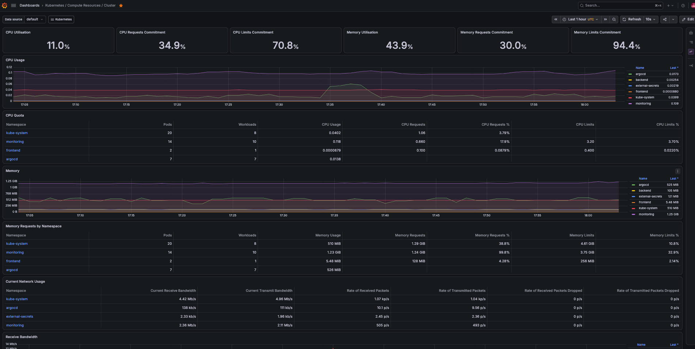
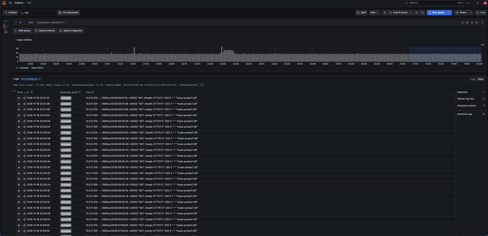
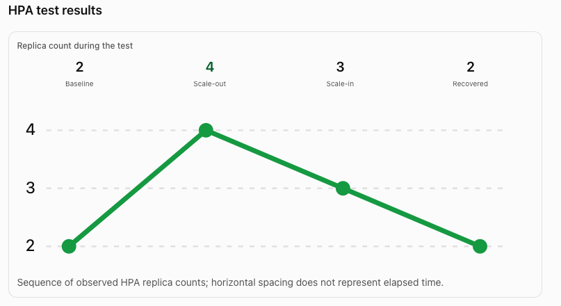

# AWS EKS Platform Engineering

**Terraform · AWS · Kubernetes · Jenkins · GitOps · Security · Observability**

A hands-on platform engineering project that provisions an AWS environment with Terraform and runs a PostgreSQL-backed Flask task manager on Amazon EKS. It connects private networking, container CI/CD, reviewed GitOps changes, workload identity, centralized monitoring, and live deployment testing into one working system.

**Project status (November 2026):** The platform was deployed and tested in `ca-central-1`. The results below describe observed development-environment behavior, not a production availability guarantee. Infrastructure teardown is a separate, controlled activity and is not represented as completed.

## 1. Architecture overview



> **Diagram boundary note:** The diagram is a high-level infographic, not a subnet placement map. The internet-facing Application Load Balancer is an AWS-managed resource associated with the VPC's public subnets, **outside the Kubernetes cluster**. RDS PostgreSQL is also outside Kubernetes, in dedicated private database subnets. AWS Secrets Manager is an AWS service, not a Kubernetes pod.

**Application request path**

```text
End user → Public Application Load Balancer → Nginx Service/Pods
         → Flask Service/Pods → Amazon RDS PostgreSQL
```

**Application delivery path**

```text
Developer → GitHub → Jenkins on private EC2
                        ├─ Unit tests → Docker build → Trivy scan/gate → Amazon ECR
                        └─ GitOps image update → GitHub pull request
                                                 ↓
                                         Review and merge
                                                 ↓
                                      Argo CD manual workload sync
                                                 ↓
                                              Amazon EKS
```

Jenkins publishes container images to ECR and proposes version-controlled manifest changes. It does **not** directly deploy the application to Kubernetes. The workload's Argo CD application was configured for **manual sync** during the verified deployment and rollback tests; sync behavior differs between Argo CD applications.

## 2. Infrastructure as code and networking

Terraform configuration is organized into reusable, service-oriented modules and a development environment. Infrastructure changes are reviewed through GitHub pull requests and validated before an intentional Terraform apply.

| Component | Implemented development configuration |
| --- | --- |
| AWS Region | `ca-central-1` (Canada Central) |
| VPC | `10.0.0.0/16` |
| Availability Zones | `ca-central-1a`, `ca-central-1b` |
| Public subnets | `10.0.1.0/24`, `10.0.2.0/24` |
| Private application subnets | `10.0.11.0/24`, `10.0.12.0/24` |
| Private database subnets | `10.0.21.0/24`, `10.0.22.0/24` |
| Outbound internet access | One NAT Gateway shared by private subnets |
| EKS | Kubernetes `1.36`; managed On-Demand node group |
| Worker capacity | Three `t3.medium` nodes, verified Ready; min 2 / max 3 |
| Database | Amazon RDS PostgreSQL, Multi-AZ |
| Image registry | Amazon ECR |
| Terraform state | S3 remote backend, separate from temporary workload resources |

**Why these choices?**

- **Private worker nodes:** Workloads run without directly assigned public IP addresses. Internet-facing traffic enters through the ALB, not the nodes.
- **Separate database subnets:** RDS is isolated from Kubernetes workloads, with network access controlled through security groups.
- **Single NAT Gateway:** Keeps the development environment less expensive and simpler to operate; it also introduces a single point of failure for private outbound internet access.
- **Managed node group:** Offers predictable compute during a learning project, at the cost of finite pod capacity.
- **Terraform modules and remote state:** Make infrastructure reviewable and repeatable while keeping state and credentials out of Git.

The environment spans two AZs, but the shared NAT Gateway and other deliberate development choices mean it should **not** be described as fully production-high-availability infrastructure.

## 3. Kubernetes and application

The application is a task manager built with **Flask and Gunicorn**, fronted by **Nginx**, with tasks stored in **PostgreSQL**. Kubernetes Deployments and Services manage the application components, while an AWS Application Load Balancer exposes the frontend.



**Observed application checks**

- Public ALB returned **HTTP 200** and served the AWS EKS Task Manager page.
- The task **“EKS deployment verified”** was created and remained visible after refreshing the page, demonstrating database persistence in that test.
- `/health` and `/ready` endpoints were exercised; successful checks were visible in application access logs.
- Rolling release and rollback were executed through the GitOps deployment workflow, with the application heading used to confirm the version change and return to the previous release.
- Saved task data remained available after the rollback.

## 4. IAM, secrets, and container security

AWS IAM responsibilities are divided across the EKS control plane, worker nodes, networking, Jenkins, and service-specific Kubernetes integrations. This reduces the need to place broad AWS credentials inside workload containers.

**Database credentials flow**

```text
AWS Secrets Manager
   ↓ authorized through EKS Pod Identity
External Secrets Operator (in Kubernetes)
   ↓ synchronizes
Kubernetes Secret
   ↓ consumed by
Flask workload / database initialization
```

**Stakater Reloader** is configured to watch relevant Secret changes. This describes its configured role; a separate Secret-rotation/restart test is not claimed here.

**Container scanning:** Jenkins integrates Trivy reporting and a gate for actionable High/Critical findings. Earlier scans detected high-severity vulnerabilities in an OS package; a targeted `zlib1g` upgrade was applied and a follow-up scan reported **zero findings under the tested scan settings**. This is not a guarantee that future images are vulnerability-free.

Additional controls include private compute placement, restricted public EKS API access, dedicated security groups, ECR image management, GitHub validation checks, and exclusion of secrets and Terraform state from version control.

## 5. CI/CD with Jenkins and GitOps with Argo CD

Jenkins runs on a **private EC2 instance** with a dedicated security group and IAM instance profile, using AWS Systems Manager for administrative access rather than an internet-facing SSH endpoint. Private outbound traffic uses the VPC's NAT connectivity.

The implemented pipeline covers source checkout, Python unit tests, Docker image build, Trivy report and security gate, publishing to ECR, and proposing a GitOps image change through a GitHub pull request.



The GitOps pull request provides a review point before the application manifest changes reach the default branch. Argo CD tracks the desired state in Git; for the tested workload releases, synchronization was initiated manually.



Argo CD application health and sync state were checked after platform setup and deployment changes. The monitoring and operator applications may use different sync policies from the application workloads.

## 6. Observability: metrics, logs, and alerts

The deployed observability stack includes **Prometheus, Grafana, Loki, Grafana Alloy, and Alertmanager**.

- **Prometheus:** Collected Kubernetes/platform metrics; **23 of 23 targets** were observed UP during verification.
- **Grafana:** Displayed cluster CPU, memory, and workload dashboards.
- **Alloy + Loki:** Forwarded and queried Kubernetes container logs, including Flask/Gunicorn access records for `/health` and `/ready`.
- **Alertmanager:** Deployed with Prometheus alert-rule evaluation and inspected through the UI. No external alert-notification delivery guarantee is claimed.





Monitoring also revealed real capacity and alert-configuration issues that informed the troubleshooting decisions below.

## 7. Validation, autoscaling, and recovery testing

| Test | Recorded result |
| --- | --- |
| Python application tests | **5 passed** using `python3 -m unittest test_app.py -v` |
| Public application access | ALB response **HTTP 200** |
| PostgreSQL integration | New task persisted after refresh |
| Release rollout | Updated application heading served by the new release |
| GitOps rollback | Previous heading restored; saved task remained |
| Horizontal Pod Autoscaler | Observed scaling from **2 to 4 pods**, followed by scale-down to **2** |
| EKS node scaling | Managed node group increased to **3 Ready nodes** |
| Prometheus target health | **23/23 UP** during the recorded check |
| Grafana and Loki | Metrics dashboards and application-log queries working |

The Flask HPA was configured with **2 minimum / 6 maximum replicas** and a **70% CPU utilization target**. The chart below summarizes the recorded scaling sequence; it is an explanatory visualization of a test, not an automatically exported production dashboard.



**Testing limits:** Deliberate worker-node draining, Prometheus/Loki persistent-volume reattachment recovery under disruptive node changes, and full infrastructure disaster-recovery restoration were **not tested to completion**. They were intentionally deferred because pod capacity was tight and disruptive experiments could have destabilized a working development cluster.

## 8. Troubleshooting and lessons learned

The platform required investigation and targeted fixes across Kubernetes controllers, Argo CD policies, container security, networking, and observability. These are examples from the recorded build, not hypothetical scenarios.

| Issue investigated | Finding | Correction and observed outcome |
| --- | --- | --- |
| **External Secrets Operator degraded in Argo CD** | Applying operator CRDs required a different apply strategy. | Enabled `ServerSideApply=true`; ESO subsequently reported **Synced/Healthy** and its pods ran. |
| **AWS Load Balancer Controller deployment blocked** | Argo CD AppProject permissions did not permit all required resource kinds, including `IngressClass` and `IngressClassParams`. | Updated project resource permissions; controller reached **Synced/Healthy** with **2 running pods**, and ALB access returned HTTP 200. |
| **Prometheus CRD installation failed** | A CRD annotation exceeded Kubernetes' annotation-size limit. | Enabled Server-Side Apply for the Prometheus Argo CD application; the monitoring stack was subsequently observed running with **23/23 Prometheus targets UP**. |
| **Trivy found OS-package vulnerabilities** | The runtime image included vulnerable `zlib1g` package versions. | Applied a targeted package upgrade, rebuilt, and rescanned; **zero findings** were reported under the verified scan settings. |
| **Workload updates did not automatically sync** | The Argo CD workload application had **no automated `syncPolicy`**. | Confirmed the policy and used manual sync for the release and rollback tests. |
| **Pod capacity became constrained** | Monitoring increased workload density across three `t3.medium` nodes; a recorded allocation was **48/51** pod slots. | Inspected node/pod allocation, kept the existing node capacity, and deferred disruptive recovery tests. |
| **Default monitoring alert noise** | Two control-plane alert rules were not appropriate for the managed EKS visibility model. | Disabled those two rules and retained relevant monitoring rules; verified the updated configuration. |

**Lessons:** A successful `terraform validate`, Kubernetes manifest check, or Helm render does not establish runtime health. CRDs, GitOps resource permissions, Pod Identity, controller behavior, and actual application requests must be verified after deployment. Equally, a disciplined engineer should document test limitations rather than risk breaking a constrained environment or claiming an unperformed test succeeded.

## 9. Engineering decisions and trade-offs

| Decision | Benefit | Trade-off |
| --- | --- | --- |
| Private Jenkins EC2 + SSM | Limits direct administrative exposure | Needs managed access and outbound networking |
| One NAT Gateway | Lower development cost | Less resilient private outbound connectivity |
| Private EKS worker nodes | Separates compute from direct internet ingress | Requires ALB and outbound routing design |
| EKS Pod Identity + ESO | Scoped cloud-secret access | Association and service-account configuration matter |
| Jenkins creates GitOps PRs | Reviewable release changes | Adds a merge step to delivery |
| Manual Argo CD workload sync | Explicit deployment control | Requires operator action |
| Managed EKS nodes | Predictable capacity and maintenance model | Can become pod-capacity constrained |
| Prometheus + Loki on EKS | Observable metrics and logs | Consumes cluster CPU, memory, storage, and pod slots |

These choices were made for a real, temporary development environment. They balance security, cost, operational complexity, and the need to test each component rather than claiming every production safeguard is present.

## 10. Repository structure and evidence

```text
aws-eks-platform-engineering/
├── app/                    # Flask application, tests, Dockerfile
├── terraform/
│   ├── environments/dev/   # Development configuration
│   └── modules/            # Reusable AWS infrastructure modules
├── kubernetes/             # Application and platform manifests
├── helm/                   # Chart versions and values
├── argocd/                 # GitOps applications and bootstrap
├── jenkins/                # Pipeline and Jenkins-related configuration
├── monitoring/             # Metrics, logs, and alerting configuration
├── docs/
│   ├── images/             # Architecture and main README visuals
│   └── evidence/           # Supporting test and operations captures
├── .github/workflows/      # Repository validation checks
└── README.md
```

**Additional evidence** (screenshots captured during the build):

- [Flask unit tests](docs/evidence/flask-unit-tests.png)
- [Rolling deployment](docs/evidence/rolling-deployment.png)
- [GitOps image pull request](docs/evidence/gitops-image-pr.png)
- [HPA terminal results](docs/evidence/hpa-terminal-results.png)
- [Three EKS worker nodes](docs/evidence/eks-worker-nodes.png)
- [Prometheus alert evaluation](docs/evidence/prometheus-alerts.png)
- [Grafana data sources](docs/evidence/grafana-data-sources.png)

Screenshots document specific observed states; they are not evidence of continuous availability. Sensitive values should be reviewed before these files are published publicly.

## 11. Cost management and teardown

The cluster was built for hands-on practice rather than uninterrupted production hosting. Main cost drivers include the EKS control plane, EC2 worker nodes, private Jenkins EC2, NAT Gateway, ALB, RDS, and persistent EBS-backed volumes.

**Controlled closeout process:** preserve code and evidence; inspect the Terraform destroy plan and service dependencies; confirm any required data retention; obtain explicit approval; then destroy project resources and verify that no unexpected billable resources remain. RDS destruction and persistent volumes can remove data. No teardown is claimed completed in this README.

The Git repository and separately maintained Terraform remote state backend are intended to remain available after workload teardown.

---

## Closing Remarks

This project represents a practical journey through designing, building, troubleshooting, and operating an AWS EKS platform. Each challenge strengthened my understanding of cloud infrastructure, Kubernetes, automation, and the engineering decisions involved in running real applications.

---

## Author

**Kamaldeep Singh**
