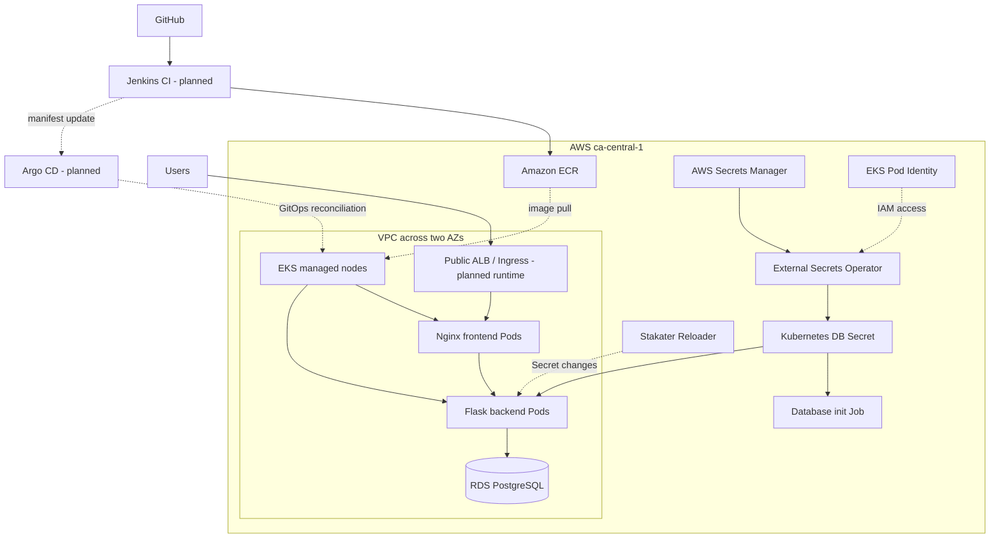

# AWS EKS Platform Engineering

**Building an AWS-hosted Kubernetes platform using Infrastructure as Code, secure networking, automated delivery, and observability.**

This project explores the design, deployment, security, and operation of a cloud-native application platform on Amazon EKS.

The infrastructure is developed incrementally using reusable Terraform modules, version-controlled changes, and Pull Request reviews. The engineering focus includes infrastructure design decisions, security boundaries, deployment reliability, troubleshooting, operational visibility, and cost management.

> **Project Status — October 2026**
>
> **Source-code milestone:** Terraform networking, IAM, EKS, RDS, ECR, application and Kubernetes integration configurations are implemented. The Kubernetes integration PR (#5) passed Terraform and Kubernetes CI validation; merge status should be confirmed before describing it as merged.
>
> **Current work:** Argo CD GitOps configuration is next, followed by Jenkins CI/CD and monitoring. AWS infrastructure deployment and end-to-end verification remain pending.
>
> **Deployment status:** ECR has been provisioned and a tested Flask image published. The EKS/VPC/RDS workload stack is not yet deployed; Kubernetes workloads have not been validated on EKS.

---

## 1. Architecture Overview

The platform is designed for Amazon EKS in `ca-central-1`. The Terraform configuration includes a two-AZ VPC, public, private application and dedicated private database subnets; a single NAT Gateway; an EKS 1.36 cluster with private managed nodes; RDS PostgreSQL; and an encrypted ECR repository with immutable tags.

The application configuration consists of an Nginx frontend proxy and a Python Flask task-manager API, with PostgreSQL persistence. AWS Secrets Manager manages the RDS master credentials. External Secrets Operator (ESO), using EKS Pod Identity, is configured to synchronize these into a Kubernetes Secret. Stakater Reloader is configured to restart Flask Pods when that Secret changes.

**Implementation boundaries:** Terraform and Kubernetes definitions are in source control, but EKS/VPC/RDS are not yet provisioned. Only the ECR repository and a tested Flask image have been deployed to AWS. Ingress-controller installation, Argo CD, Jenkins and the monitoring stack require their own implementation and runtime verification.

### Target Architecture



**Diagram legend:** Connections depict intended runtime behavior, not proof of deployment. Helm values for ESO and Reloader exist; controllers and GitOps are not installed on EKS yet.
---

## 2. Networking Design

| Component | Configuration |
|---|---|
| AWS Region | `ca-central-1` — Canada Central |
| VPC CIDR | `10.0.0.0/16` |
| Availability Zones | `ca-central-1a`, `ca-central-1b` |
| Public subnet A | `10.0.1.0/24` |
| Public subnet B | `10.0.2.0/24` |
| Private subnet A | `10.0.11.0/24` |
| Private subnet B | `10.0.12.0/24` |
| Internet Gateway | One |
| NAT Gateway | One, shared across private subnets |
| Private routing | Separate route table per AZ |
| Worker-node placement | Private subnets |
| Subnet discovery | Kubernetes load balancer discovery tags |

### Networking Decisions

**Multi-AZ networking**

The VPC uses two Availability Zones to support workload distribution and provide a foundation for higher availability.

**Private worker nodes**

EKS managed worker nodes are placed in private subnets without directly assigned public IP addresses.

**Controlled outbound connectivity**

Private subnet route tables direct internet-bound traffic through a NAT Gateway.

**Development cost trade-off**

A single NAT Gateway is used to reduce development costs. This introduces a cross-AZ dependency and a potential single point of failure for private outbound connectivity.

The design is intentional for a temporary development environment and should not be interpreted as a fully production-ready high-availability configuration.

---

## 3. Amazon EKS Configuration

The EKS cluster is configured using a dedicated reusable Terraform module.

| Configuration | Value |
|---|---|
| Kubernetes version | `1.36` |
| Compute | EKS managed node group |
| EC2 instance type | `t3.medium` |
| Capacity type | On-Demand |
| Desired nodes | 2 |
| Minimum nodes | 2 |
| Maximum nodes | 3 |
| Node update strategy | `max_unavailable = 1` |
| Worker subnets | Private, across two AZs |
| Private API endpoint | Enabled |
| Public API endpoint | Enabled, restricted to an explicit `/32` CIDR |

### Cluster Access

The Kubernetes API endpoint supports private connectivity and restricted public access.

The allowed public CIDR is supplied through an environment-specific Terraform variable rather than hardcoded into the reusable EKS module.

### Managed Node Groups

The initial compute configuration prioritizes a small, predictable infrastructure footprint for development and deployment verification.

Node scaling is configured at the managed node group level. Workload-level autoscaling using HPA and more advanced node provisioning through Karpenter will be introduced in later phases.

---

## 4. IAM and Security Architecture

The IAM module separates permissions according to the responsibilities of each AWS component.

### EKS Cluster Role

Trusted AWS service: `eks.amazonaws.com`

Attached policy:

- `AmazonEKSClusterPolicy`

This role provides the permissions required by the EKS control plane to interact with supported AWS services.

### EKS Worker Node Role

Trusted AWS service: `ec2.amazonaws.com`

Attached policies:

- `AmazonEKSWorkerNodePolicy`
- `AmazonEC2ContainerRegistryPullOnly`

This role provides required worker-node permissions and read access to retrieve container images from Amazon ECR.

### VPC CNI Pod Identity Role

Trusted AWS service: `pods.eks.amazonaws.com`

Trust actions:

- `sts:AssumeRole`
- `sts:TagSession`

Attached policy:

- `AmazonEKS_CNI_Policy`

The VPC CNI add-on uses EKS Pod Identity to associate its `aws-node` Kubernetes service account with this dedicated IAM role.

This separates networking permissions from the EC2 worker-node role.

### Security Design Principles

- Separate IAM roles for control plane, compute, and networking responsibilities.
- Use dedicated permissions appropriate to each component.
- Host managed worker nodes in private subnets.
- Restrict public Kubernetes API access.
- Avoid committing credentials, local Terraform variable files, and sensitive state contents.
- Keep infrastructure changes reviewable through Git and Pull Requests.

Additional workload-level security, network isolation, vulnerability scanning, and operational security validation are planned.

---

## 5. EKS Managed Add-ons

Four core EKS add-ons are managed explicitly through Terraform.

| Add-on | Pinned version | Responsibility |
|---|---|---|
| Amazon VPC CNI | `v1.22.4-eksbuild.3` | Pod networking and IP address allocation |
| kube-proxy | `v1.36.0-eksbuild.48` | Kubernetes Service traffic handling |
| CoreDNS | `v1.14.7-eksbuild.11` | Internal Kubernetes DNS |
| EKS Pod Identity Agent | `v1.3.10-eksbuild.3` | Credential delivery to authorized Pods |

Add-on versions were checked against AWS-reported compatibility and default-version information for Kubernetes 1.36 in `ca-central-1`.

Versions are explicitly pinned for reproducibility and must be reviewed when upgrading Kubernetes or applying security and maintenance updates.

### Resource Dependencies

The Terraform implementation defines dependencies between:

- IAM policy attachments and the EKS module.
- EKS control plane and managed add-ons.
- Pod Identity Agent and VPC CNI.
- VPC CNI and managed worker nodes.
- Managed worker nodes and CoreDNS.

These dependencies coordinate provisioning order.

**Runtime consideration:** Terraform validation does not prove Kubernetes add-on health. Initial provisioning must verify node registration, add-on bootstrap behavior, Pod Identity functionality, and networking readiness.

---

## 6. Repository Structure

Key directories and files (abridged):

```text
aws-eks-platform-engineering/
├── app/
│   ├── app.py
│   ├── init_db.py
│   ├── requirements.txt
│   └── Dockerfile
├── terraform/
│   ├── environments/dev/
│   │   ├── main.tf
│   │   ├── secrets-iam.tf
│   │   ├── outputs.tf
│   │   ├── backend.tf
│   │   └── ...
│   └── modules/
│       ├── vpc/
│       ├── iam/
│       ├── eks/
│       ├── rds/
│       └── ecr/
├── kubernetes/
│   ├── flask/
│   │   ├── deployment.yaml
│   │   └── init-db-job.yaml
│   ├── external-secrets/
│   │   ├── secret-store.yaml
│   │   └── external-secret.yaml
│   └── ... (Nginx, ingress, policies, namespaces, services)
├── helm/
│   ├── external-secrets/values.yaml
│   ├── reloader/values.yaml
│   └── versions.yaml
├── argocd/          # In progress; separate feature branch
├── jenkins/         # Planned
├── monitoring/      # Planned
├── .github/workflows/validate.yml
└── README.md
```

`helm/versions.yaml` records selected chart versions; it is **not** a Helmfile or an automatic chart installer. The repository separates infrastructure modules, application artifacts, Kubernetes manifests, and platform add-on configuration.

State snapshots, credentials, local Terraform variables, and generated plans must not be committed.
---

## 7. Technology Stack

| Area | Technology | Verified state |
|---|---|---|
| Infrastructure as Code | Terraform | VPC, IAM, EKS, RDS, ECR and ESO Pod Identity configurations written and validated |
| Terraform state | S3 remote backend | Encryption, versioning and locking configured; backend region `us-east-2` |
| AWS workload Region | Canada Central | `ca-central-1` |
| Kubernetes | EKS 1.36, managed nodes | Defined, not yet provisioned |
| Containers and registry | Docker, Amazon ECR | ECR provisioned; Flask `v3` image built, tested and pushed |
| Application | Flask, Nginx | Flask source and image available; Kubernetes/Nginx manifests prepared; EKS deployment pending |
| Database | RDS PostgreSQL | Terraform configuration present; deployment and connectivity pending |
| Secrets and identity | Secrets Manager, ESO, EKS Pod Identity | IAM + manifests defined; ESO runtime and secret sync not tested |
| Helm | ESO `2.14.0`, Reloader `2.2.19` | Values and version record; charts rendered locally, not installed on EKS |
| Kubernetes validation | Kubeconform, GitHub Actions | 18/18 resources schema-valid, including ESO CRDs; no skipped resources |
| Network isolation | Kubernetes NetworkPolicies | Manifests prepared; enforcement not yet tested |
| Ingress | AWS Load Balancer Controller | Ingress design/manifests present; controller provisioning remains a dependency |
| GitOps | Argo CD | Separate feature branch planned/in progress |
| Continuous delivery | Jenkins | Planned |
| Image scanning | Trivy | Flask image scanned; remaining high-severity OS findings require review |
| Observability | Prometheus, Grafana, Loki | Planned; not deployed |
| Autoscaling | HPA, Karpenter | Future work, not implemented |

**Validation is not deployment:** local formatting, schema checking, chart rendering and successful image publishing do not establish EKS workload health.
---

## 8. Infrastructure Workflow

Development follows a reviewed infrastructure-as-code workflow:

```text
Design
  ↓
Implement
  ↓
Format and Validate
  ↓
Terraform Plan
  ↓
Review Changes
  ↓
Git Commit
  ↓
Pull Request
  ↓
Merge to Main
  ↓
Controlled Deployment
  ↓
Runtime Verification
```

### Terraform Commands

Run Terraform from the development environment:

```bash
cd terraform/environments/dev

terraform init
terraform fmt -check -recursive
terraform validate
terraform plan -input=false
```

### Deployment Controls

Infrastructure deployment is a separate, deliberate step after code review.

Before applying, the deployment workflow includes:

- Verification of AWS identity and target Region.
- Review of the current Terraform plan.
- Confirmation of required credentials and variable inputs.
- Review of IAM access, resource dependencies, and bootstrap requirements.
- Cost and teardown considerations.

ECR has already been deployed for image publishing; provisioning of the EKS/VPC/RDS stack is pending.

### Terraform State

Terraform uses an existing S3 remote backend with encryption, versioning, and state locking.

The backend is maintained separately from the ephemeral project infrastructure.

Credentials, state snapshots, local variable values, and generated plan artifacts should not be committed to the repository.

---

## 9. Cost Management and Teardown

The project uses a temporary development environment rather than maintaining a continuously running EKS cluster.

The intended operational workflow is:

```text
Provision infrastructure
        ↓
Verify cluster health
        ↓
Perform project tasks
        ↓
Capture useful evidence
        ↓
Review destroy plan
        ↓
Destroy project resources
        ↓
Verify cleanup
```

### Cost Considerations

Primary billable components include:

- EKS control plane.
- EC2 managed worker nodes.
- NAT Gateway and data processing.
- Public IPv4 addresses.
- Worker-node EBS volumes.
- Load balancers, RDS databases, and other provisioned services.

Billing begins as resources are provisioned and continues until they are removed according to AWS billing rules.

After each practice session, the intention is to destroy temporary project infrastructure and verify that no unintended billable resources remain.

The reusable Terraform code, GitHub repository, and separately maintained remote state backend are retained.

**Important:** Infrastructure teardown may remove workloads and persistent resources. Required application data and operational evidence must be preserved before destruction.

---

## 10. Validation and Implementation Evidence

### VPC / IAM / EKS foundation

- VPC, IAM and EKS Terraform modules passed local validation and planning.
- Earlier milestones recorded plans of **18 additions** (VPC) and **31 additions** (IAM/EKS); those are historical snapshots, not the current infrastructure plan.
- Managed EKS add-on compatibility and resource dependencies were reviewed.

### Application and integration checkpoint (PR #5)

- Flask task-manager source, database initialization script, multi-stage Dockerfile and ECR Terraform module added.
- Docker image `eks-flask-app:v3` built for `linux/amd64`, locally tested, pushed to ECR; image digest recorded during verification.
- Terraform database secret ARN output and scoped ESO Pod Identity permissions added.
- Kubernetes Deployment, initialization Job, SecretStore and ExternalSecret configured.
- ESO and Reloader Helm charts rendered locally from pinned versions.
- GitHub Actions **Terraform validation and Kubernetes validation passed** after fixes to Terraform formatting and ESO service enum casing.
- Final Kubeconform result: **18 resources in 15 files; 18 valid, 0 invalid, 0 errors, 0 skipped**, using the ESO CRD schema catalog.

### Open checks and security findings

- The RDS endpoint and secret ARN placeholders must be populated from Terraform outputs after provision; these values are not passwords.
- Validate EKS, Pod Identity, ESO secret synchronization, init Job, Flask-to-RDS access and Reloader restart behavior on the deployed cluster.
- Verify AWS Load Balancer Controller installation and ingress behavior before treating external access as complete.
- A Trivy scan of the published runtime image reported **44 High OS vulnerability findings**, with no Critical or Python findings in that scan. Remediation or documented risk assessment is still pending.
- No actual EKS workload deployment, database integration test, monitoring dashboard or GitOps reconciliation has been completed.

**Evidence boundary:** The checks above establish code/schema/build validity, not an operational or production-ready platform.
---

## 11. Project Roadmap

This roadmap distinguishes source-code work from actual cloud deployment. A configuration can be implemented without the corresponding running service having been verified.

| Area | Implementation status | Runtime status |
|---|---|---|
| Repository, Git workflow, Terraform backend | Implemented | Backend configured |
| VPC, IAM, EKS and managed add-ons | Terraform defined and validated | Not deployed |
| RDS, managed credentials and ECR | Terraform modules defined and validated | ECR deployed; RDS not deployed |
| Flask image and Kubernetes workload manifests | Implemented; image published; manifests schema-valid | EKS workload not deployed |
| Secrets integration / Pod Identity | Terraform, ESO manifests and Helm values written | Not tested on EKS |
| Helm add-ons (ESO, Reloader) | Chart versions and values verified | Not installed on EKS |
| Ingress and network policies | Kubernetes definitions prepared | Controller/enforcement not verified |
| Argo CD GitOps | Next separate feature branch | Not installed |
| Jenkins CI/CD and Trivy gating | Planned; image scan performed manually | Pipeline not implemented |
| Prometheus, Grafana, Loki | Planned | Not deployed |
| HPA, Karpenter, resilience testing | Future scope | Not deployed |
| Operational tests, documentation, teardown | Validation evidence collected; README maintained | End-to-end verification and teardown pending |

### Next Steps

1. Merge validated application-integration work into `main` if PR #5 has not already been merged; keep PR checks green.
2. Implement Argo CD on `feature/argocd-gitops`, then Jenkins and monitoring in separate reviewable branches.
3. Confirm prerequisites for deployment, including Load Balancer Controller and chart/operator installation order.
4. Provision and verify infrastructure, replace the nonsecret RDS output placeholders, and test database, ESO and application behavior.
5. Capture evidence, review any security findings, then intentionally tear down chargeable resources while retaining source code and the separately managed state backend.
---

## 12. Engineering Considerations

This implementation prioritizes modular infrastructure, least-privilege IAM access, explicit resource dependencies, and reproducible Terraform configurations.

Architecture decisions are evaluated against security, reliability, operational complexity, maintainability, and development costs.

The goal is to establish a secure, maintainable, and scalable Kubernetes foundation that supports future application deployments and platform engineering capabilities.

The project emphasizes validating actual infrastructure behavior, documenting operational findings, and evolving the platform through controlled and reviewable changes.