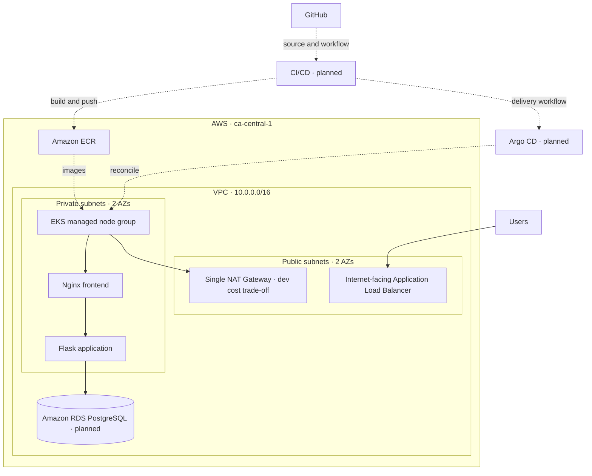

# AWS EKS Platform Engineering

**Building an AWS-hosted Kubernetes platform with Infrastructure as Code, secure networking, automated delivery, and observability.**

This is a hands-on platform engineering project built incrementally to explore how cloud infrastructure and Kubernetes workloads are designed, delivered, secured, monitored, and operated. The focus is not just on making an application run, but on documenting engineering decisions, validating changes, and understanding failure modes.

> **Project status — October 2026:** Repository foundation and Terraform VPC configuration are complete and merged into `main`. IAM and EKS configuration are next. **No AWS infrastructure has been deployed for this project yet.**

## Architecture

The target architecture will evolve in stages:



**Diagram shows the intended platform, not currently deployed resources.** Application Load Balancer, EKS, RDS, CI/CD, and GitOps are future milestones. The currently merged Terraform code defines the VPC networking layer only.

### Networking design

| Component | Configuration |
| --- | --- |
| AWS Region | `ca-central-1` (Canada Central) |
| VPC | `10.0.0.0/16` |
| Availability Zones | `ca-central-1a`, `ca-central-1b` |
| Public subnet — AZ A | `10.0.1.0/24` |
| Public subnet — AZ B | `10.0.2.0/24` |
| Private subnet — AZ A | `10.0.11.0/24` |
| Private subnet — AZ B | `10.0.12.0/24` |
| Public routing | Default route to Internet Gateway |
| Private routing | Separate route table per AZ, both using one NAT Gateway |
| Kubernetes discovery tags | Public and internal load balancer subnet tags |

**Development trade-off:** A single zonal NAT Gateway reduces costs compared with one per AZ, but creates a cross-AZ dependency for outbound traffic from the other private subnet. This is intentional for the initial development environment, not a claim of full production-grade high availability.

## Technology stack

| Area | Technology | Status |
| --- | --- | --- |
| Infrastructure as Code | Terraform, AWS provider | VPC module complete |
| Version control | Git, GitHub, feature branches, Pull Requests | In use |
| Networking | Amazon VPC, subnets, route tables, IGW, NAT Gateway | Configured in Terraform |
| Identity | AWS IAM roles and policies | Next |
| Kubernetes | Amazon EKS, managed node groups | Planned |
| Containers | Docker, Amazon ECR | Planned integration; existing Flask image available |
| Application | Nginx and Python Flask | Planned deployment |
| Database | Amazon RDS for PostgreSQL | Planned |
| Delivery | Jenkins, Helm, Argo CD | Planned |
| Observability | Prometheus, Grafana, Loki | Planned |
| Scaling | HPA, metrics-server, Karpenter | Planned |
| Security | IAM least privilege, workload identity, NetworkPolicies | Planned incrementally |

## Project roadmap

Progress below describes **configuration and project milestones**, not deployed AWS resources.

| Phase | Milestone | Status |
| --- | --- | --- |
| 1 | Project preparation, GitHub and Terraform backend | ✅ Complete |
| 2 | Reusable multi-AZ VPC networking module | ✅ Complete — PR [#1](https://github.com/kamaldeepsingh039/aws-eks-platform-engineering/pull/1) merged |
| 3 | IAM roles, EKS control plane and managed worker nodes | 🔜 Next |
| 4 | Foundational AWS deployment and verification | Not started |
| 5 | Kubernetes workloads: Nginx, Flask and database connectivity | Not started |
| 6 | ALB Ingress, network isolation and security controls | Not started |
| 7 | Helm, Jenkins CI/CD, ECR and Argo CD GitOps | Not started |
| 8 | Observability and horizontal pod autoscaling | Not started |
| 9 | Advanced scaling, resilience and cost optimization | Not started |
| 10 | Testing, troubleshooting, documentation and portfolio review | Not started |

**Deployment status: 0 AWS resources deployed by this project's Terraform configuration.** Terraform `plan` is a preview, not an infrastructure deployment.

## Repository structure

```text
aws-eks-platform-engineering/
├── terraform/
│   ├── environments/
│   │   └── dev/
│   │       ├── backend.tf
│   │       ├── main.tf
│   │       ├── providers.tf
│   │       └── versions.tf
│   └── modules/
│       ├── vpc/
│       │   ├── main.tf
│       │   ├── variables.tf
│       │   └── outputs.tf
│       ├── iam/                  # Configuration planned
│       └── eks/                  # Configuration planned
└── README.md
```

Some local-only files, such as Terraform's provider lock file and working directories, are not shown. IAM and EKS module directories are placeholders until their implementation is added.

## Infrastructure workflow

The project uses small feature branches and Pull Requests rather than committing changes directly to `main`.

```text
Design → Implement → Format → Validate → Plan → Review → Commit → PR → Merge
```

Terraform commands are run from the development root module:

```bash
cd terraform/environments/dev
terraform init
terraform fmt -check -recursive
terraform validate
terraform plan -input=false
```

**Do not run `terraform apply` based on the current VPC-only configuration.** The current approach is to configure and review the foundational VPC, IAM, EKS, and managed node groups together before the initial AWS deployment. A fresh consolidated plan, access review and cost review will precede any apply.

The development environment uses remote Terraform state in an encrypted, versioned S3 backend with lockfile-based state locking. State contents, account identifiers, credentials, private variables and temporary plan files are not intended for this repository.

## Engineering decisions and learning

- **Reusable modules:** Keep reusable VPC, IAM and EKS infrastructure separate from environment-specific composition.
- **Two Availability Zones:** Prepare the network for workloads spread across AZs.
- **Private workers:** Keep the planned Kubernetes worker nodes off public subnets.
- **Cost-aware NAT design:** Start with one NAT Gateway and explicitly document the availability trade-off.
- **Review before deployment:** Use formatting, validation, execution plans and PR review to catch mistakes before they become infrastructure changes.
- **Evidence-based documentation:** Mark features as implemented only when they are actually configured and tested; clearly distinguish plans from deployment verification.

## Current validation evidence

The VPC module passed local formatting and configuration validation. Its reviewed Terraform plan reported:

```text
Plan: 18 to add, 0 to change, 0 to destroy.
```

This is a **pre-deployment plan result**, not a successful deployment test.

The networking work was merged through [Pull Request #1](https://github.com/kamaldeepsingh039/aws-eks-platform-engineering/pull/1). Future phases will add deployment verification, workload tests, monitoring evidence and troubleshooting notes as those stages are completed.

## Next milestone

Implement IAM trust relationships and permission attachments, followed by the EKS cluster and managed worker node group Terraform configuration. Validate and review the complete infrastructure before the first apply.

---

**Project principle:** Build thoughtfully. Validate changes. Learn from failures. Document the evidence.
