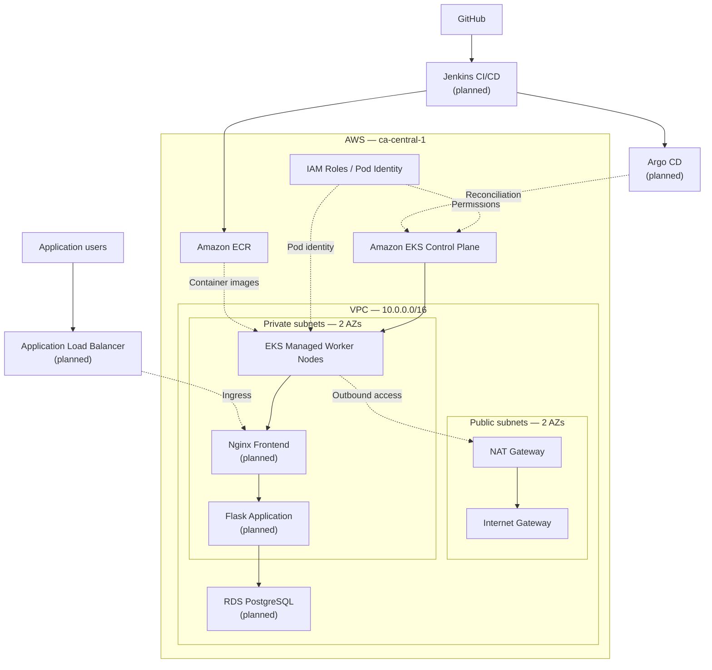

# AWS EKS Platform Engineering

**Building an AWS-hosted Kubernetes platform using Infrastructure as Code, secure networking, automated delivery, and observability.**

This project explores the design, deployment, security, and operation of a cloud-native application platform on Amazon EKS.

The infrastructure is developed incrementally using reusable Terraform modules, version-controlled changes, and Pull Request reviews. The engineering focus includes infrastructure design decisions, security boundaries, deployment reliability, troubleshooting, operational visibility, and cost management.

> **Project Status — October 2026**
>
> **Phases 1–3 complete:** Repository foundation, multi-AZ VPC networking, IAM roles, and Amazon EKS configuration are implemented and merged into `main`.
>
> **Current milestone:** Phase 4 — AWS infrastructure deployment and verification.
>
> **Deployment status:** The infrastructure is configured and validated through Terraform. AWS resources for this project have not yet been deployed.

---

## 1. Architecture Overview

The platform is designed around an Amazon EKS cluster hosted within a custom AWS VPC in the Canada Central Region (`ca-central-1`).

The current Terraform implementation defines:

- A VPC spanning two Availability Zones.
- Public and private subnets with separate routing.
- An Internet Gateway and single NAT Gateway.
- Amazon EKS running Kubernetes 1.36.
- A managed worker-node group hosted in private subnets.
- Dedicated IAM roles for EKS, EC2 worker nodes, and VPC CNI.
- EKS managed networking, DNS, and Pod Identity add-ons.

Future phases will introduce application workloads, ingress, persistent data, automated delivery, GitOps, security scanning, and observability.

### Target Architecture



**Architecture status:** The VPC, IAM, EKS, and managed add-on resources are defined in Terraform. The diagram also includes planned application and delivery components that are not yet implemented in this project.

---

## 2. Networking Design

| Component | Configuration |
|---|---|
| AWS Region | `ca-central-1` — Canada Central |
| VPC CIDR | `10.0.0.0/16` |
| Availability Zones | `ca-central-1a`, `ca-central-1b` |
| Public subnet A | `10.0.1.0/24` |
| Public subnet B | `10.0.2.0/24` |
| Private subnet A | `10.0.11.0/24` |
| Private subnet B | `10.0.12.0/24` |
| Internet Gateway | One |
| NAT Gateway | One, shared across private subnets |
| Private routing | Separate route table per AZ |
| Worker-node placement | Private subnets |
| Subnet discovery | Kubernetes load balancer discovery tags |

### Networking Decisions

**Multi-AZ networking**

The VPC uses two Availability Zones to support workload distribution and provide a foundation for higher availability.

**Private worker nodes**

EKS managed worker nodes are placed in private subnets without directly assigned public IP addresses.

**Controlled outbound connectivity**

Private subnet route tables direct internet-bound traffic through a NAT Gateway.

**Development cost trade-off**

A single NAT Gateway is used to reduce development costs. This introduces a cross-AZ dependency and a potential single point of failure for private outbound connectivity.

The design is intentional for a temporary development environment and should not be interpreted as a fully production-ready high-availability configuration.

---

## 3. Amazon EKS Configuration

The EKS cluster is configured using a dedicated reusable Terraform module.

| Configuration | Value |
|---|---|
| Kubernetes version | `1.36` |
| Compute | EKS managed node group |
| EC2 instance type | `t3.medium` |
| Capacity type | On-Demand |
| Desired nodes | 2 |
| Minimum nodes | 2 |
| Maximum nodes | 3 |
| Node update strategy | `max_unavailable = 1` |
| Worker subnets | Private, across two AZs |
| Private API endpoint | Enabled |
| Public API endpoint | Enabled, restricted to an explicit `/32` CIDR |

### Cluster Access

The Kubernetes API endpoint supports private connectivity and restricted public access.

The allowed public CIDR is supplied through an environment-specific Terraform variable rather than hardcoded into the reusable EKS module.

### Managed Node Groups

The initial compute configuration prioritizes a small, predictable infrastructure footprint for development and deployment verification.

Node scaling is configured at the managed node group level. Workload-level autoscaling using HPA and more advanced node provisioning through Karpenter will be introduced in later phases.

---

## 4. IAM and Security Architecture

The IAM module separates permissions according to the responsibilities of each AWS component.

### EKS Cluster Role

Trusted AWS service: `eks.amazonaws.com`

Attached policy:

- `AmazonEKSClusterPolicy`

This role provides the permissions required by the EKS control plane to interact with supported AWS services.

### EKS Worker Node Role

Trusted AWS service: `ec2.amazonaws.com`

Attached policies:

- `AmazonEKSWorkerNodePolicy`
- `AmazonEC2ContainerRegistryPullOnly`

This role provides required worker-node permissions and read access to retrieve container images from Amazon ECR.

### VPC CNI Pod Identity Role

Trusted AWS service: `pods.eks.amazonaws.com`

Trust actions:

- `sts:AssumeRole`
- `sts:TagSession`

Attached policy:

- `AmazonEKS_CNI_Policy`

The VPC CNI add-on uses EKS Pod Identity to associate its `aws-node` Kubernetes service account with this dedicated IAM role.

This separates networking permissions from the EC2 worker-node role.

### Security Design Principles

- Separate IAM roles for control plane, compute, and networking responsibilities.
- Use dedicated permissions appropriate to each component.
- Host managed worker nodes in private subnets.
- Restrict public Kubernetes API access.
- Avoid committing credentials, local Terraform variable files, and sensitive state contents.
- Keep infrastructure changes reviewable through Git and Pull Requests.

Additional workload-level security, network isolation, vulnerability scanning, and operational security validation are planned.

---

## 5. EKS Managed Add-ons

Four core EKS add-ons are managed explicitly through Terraform.

| Add-on | Pinned version | Responsibility |
|---|---|---|
| Amazon VPC CNI | `v1.22.4-eksbuild.3` | Pod networking and IP address allocation |
| kube-proxy | `v1.36.0-eksbuild.48` | Kubernetes Service traffic handling |
| CoreDNS | `v1.14.7-eksbuild.11` | Internal Kubernetes DNS |
| EKS Pod Identity Agent | `v1.3.10-eksbuild.3` | Credential delivery to authorized Pods |

Add-on versions were checked against AWS-reported compatibility and default-version information for Kubernetes 1.36 in `ca-central-1`.

Versions are explicitly pinned for reproducibility and must be reviewed when upgrading Kubernetes or applying security and maintenance updates.

### Resource Dependencies

The Terraform implementation defines dependencies between:

- IAM policy attachments and the EKS module.
- EKS control plane and managed add-ons.
- Pod Identity Agent and VPC CNI.
- VPC CNI and managed worker nodes.
- Managed worker nodes and CoreDNS.

These dependencies coordinate provisioning order.

**Runtime consideration:** Terraform validation does not prove Kubernetes add-on health. Initial provisioning must verify node registration, add-on bootstrap behavior, Pod Identity functionality, and networking readiness.

---

## 6. Repository Structure

```text
aws-eks-platform-engineering/
├── terraform/
│   ├── environments/
│   │   └── dev/
│   │       ├── backend.tf
│   │       ├── main.tf
│   │       ├── providers.tf
│   │       ├── variables.tf
│   │       └── versions.tf
│   └── modules/
│       ├── vpc/
│       │   ├── main.tf
│       │   ├── variables.tf
│       │   └── outputs.tf
│       ├── iam/
│       │   ├── main.tf
│       │   ├── variables.tf
│       │   └── outputs.tf
│       └── eks/
│           ├── main.tf
│           ├── variables.tf
│           └── outputs.tf
└── README.md
```

The Terraform implementation separates reusable infrastructure modules from environment-specific configuration.

Local Terraform working directories, variable values, temporary plans, and other sensitive or generated files are excluded from the repository as appropriate.

---

## 7. Technology Stack

| Area | Technology | Current status |
|---|---|---|
| Infrastructure as Code | Terraform, AWS Provider | VPC, IAM, EKS implemented |
| State management | Amazon S3, Terraform locking | Configured |
| Source control | Git, GitHub, Pull Requests | In use |
| Networking | VPC, subnets, IGW, NAT Gateway | Configured in Terraform |
| Identity | AWS IAM, EKS Pod Identity | Configured in Terraform |
| Kubernetes | Amazon EKS, managed node groups | Configured in Terraform |
| Core networking | VPC CNI, kube-proxy, CoreDNS | Configured in Terraform |
| Containers | Docker, Amazon ECR | Integration planned |
| Applications | Nginx, Python Flask | Deployment planned |
| Database | Amazon RDS PostgreSQL | Planned |
| Ingress | AWS Load Balancer Controller | Planned |
| Delivery | Jenkins, Helm, Argo CD | Planned |
| Security scanning | Trivy | Planned |
| Observability | Prometheus, Grafana, Loki | Planned |
| Autoscaling | HPA, metrics-server, Karpenter | Planned |
| Network security | Kubernetes NetworkPolicies | Planned |

---

## 8. Infrastructure Workflow

Development follows a reviewed infrastructure-as-code workflow:

```text
Design
  ↓
Implement
  ↓
Format and Validate
  ↓
Terraform Plan
  ↓
Review Changes
  ↓
Git Commit
  ↓
Pull Request
  ↓
Merge to Main
  ↓
Controlled Deployment
  ↓
Runtime Verification
```

### Terraform Commands

Run Terraform from the development environment:

```bash
cd terraform/environments/dev

terraform init
terraform fmt -check -recursive
terraform validate
terraform plan -input=false
```

### Deployment Controls

Infrastructure deployment is a separate, deliberate step after code review.

Before applying, the deployment workflow includes:

- Verification of AWS identity and target Region.
- Review of the current Terraform plan.
- Confirmation of required credentials and variable inputs.
- Review of IAM access, resource dependencies, and bootstrap requirements.
- Cost and teardown considerations.

The initial AWS deployment is pending.

### Terraform State

Terraform uses an existing S3 remote backend with encryption, versioning, and state locking.

The backend is maintained separately from the ephemeral project infrastructure.

Credentials, state snapshots, local variable values, and generated plan artifacts should not be committed to the repository.

---

## 9. Cost Management and Teardown

The project uses a temporary development environment rather than maintaining a continuously running EKS cluster.

The intended operational workflow is:

```text
Provision infrastructure
        ↓
Verify cluster health
        ↓
Perform project tasks
        ↓
Capture useful evidence
        ↓
Review destroy plan
        ↓
Destroy project resources
        ↓
Verify cleanup
```

### Cost Considerations

Primary billable components include:

- EKS control plane.
- EC2 managed worker nodes.
- NAT Gateway and data processing.
- Public IPv4 addresses.
- Worker-node EBS volumes.
- Future load balancers, databases, and additional services.

Billing begins as resources are provisioned and continues until they are removed according to AWS billing rules.

After each practice session, the intention is to destroy temporary project infrastructure and verify that no unintended billable resources remain.

The reusable Terraform code, GitHub repository, and separately maintained remote state backend are retained.

**Important:** Infrastructure teardown may remove workloads and persistent resources. Required application data and operational evidence must be preserved before destruction.

---

## 10. Validation and Implementation Evidence

### Phase 2 — VPC Networking

The VPC module passed Terraform validation and planning.

```text
Plan: 18 to add, 0 to change, 0 to destroy.
```

Networking implementation was reviewed and merged through Pull Request #1.

### Phase 3 — IAM and EKS

The consolidated Terraform configuration passed formatting, validation, and plan review.

```text
Plan: 31 to add, 0 to change, 0 to destroy.
```

Additional checks included:

- Review of IAM trust policies and AWS-managed policy attachments.
- Verification of EKS module inputs and outputs.
- AWS CLI checks for managed add-on version compatibility.
- Review of cluster, add-on, and managed node group dependencies.
- Git staged-change and whitespace verification.
- Pull Request review and merge into `main`.

**Validation boundary:** These results confirm the configuration can be planned successfully. They do not establish that AWS resources have been deployed or that Kubernetes workloads are healthy.

---

## 11. Project Roadmap

Progress refers to implementation milestones, not necessarily AWS deployment status.

| Phase | Milestone | Status |
|---|---|---|
| 1 | Project preparation, tooling, GitHub repository and Terraform backend | Complete |
| 2 | Reusable multi-AZ VPC networking module | Complete |
| 3 | IAM roles, EKS control plane, managed node groups and add-ons | Complete |
| 4 | AWS infrastructure deployment and verification | Next |
| 5 | Kubernetes workloads: Nginx, Flask and database connectivity | Planned |
| 6 | ALB Ingress, network isolation and security | Planned |
| 7 | Helm, Jenkins CI/CD, ECR, Argo CD and Trivy | Planned |
| 8 | Observability, metrics, logging and HPA | Planned |
| 9 | Karpenter, resilience and cost optimization | Planned |
| 10 | Operational testing, troubleshooting and portfolio documentation | Planned |

### Next Milestone: Phase 4

The next phase focuses on provisioning the AWS infrastructure and validating operational readiness.

Key objectives include verifying:

- Cluster provisioning and API connectivity.
- IAM permissions and authentication.
- Managed worker-node registration and readiness.
- VPC CNI and Pod Identity integration.
- CoreDNS and kube-proxy health.
- Private subnet connectivity and outbound routing.
- Terraform teardown and cleanup.

Deployment findings and remediation work will be documented as the environment is tested.

---

## 12. Engineering Considerations

This implementation prioritizes modular infrastructure, least-privilege IAM access, explicit resource dependencies, and reproducible Terraform configurations.

Architecture decisions are evaluated against security, reliability, operational complexity, maintainability, and development costs.

The goal is to establish a secure, maintainable, and scalable Kubernetes foundation that supports future application deployments and platform engineering capabilities.

The project emphasizes validating actual infrastructure behavior, documenting operational findings, and evolving the platform through controlled and reviewable changes.